<p align="center">
  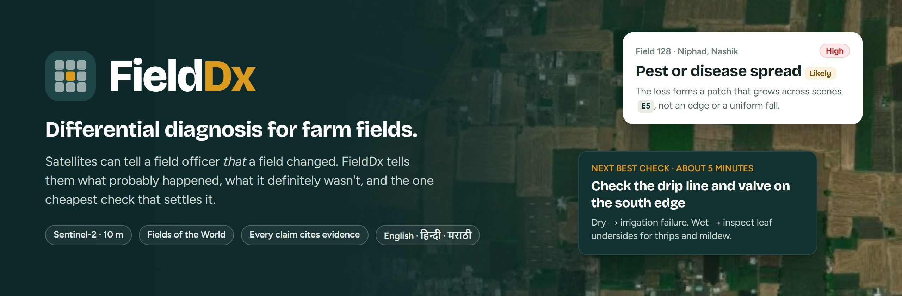
</p>

<p align="center">
  
  
  
  
  
  
</p>

<p align="center">
  <a href="#monday-710-am-niphad">The problem</a> ·
  <a href="#what-fielddx-does">What it does</a> ·
  <a href="#a-walk-through-the-app">Screens</a> ·
  <a href="#how-fielddx-thinks">How it thinks</a> ·
  <a href="#architecture">Architecture</a> ·
  <a href="#india-first">India first</a> ·
  <a href="#then-the-world">Then the world</a> ·
  <a href="#run-it">Run it</a>
</p>

---

## Monday, 7:10 am, Niphad

You are the field officer for a farmer producer organisation in the grape and onion belt of Nashik. A few hundred member farmers have your number. Last season unseasonal rain ruined vineyards across the district, about 45,000 hectares by the first estimates,<sup>[6]</sup> and every one of those farmers remembers whether someone came.

The satellite map on your phone shows **68 fields that lost green in the last three weeks**. You have one day, and time for perhaps fifteen farms.

Which fifteen?

Some of that red is a hazy pass the satellite half-saw. Some is a field cut for harvest, exactly on schedule. Seventeen of those fields are a whole neighbourhood drying out in the same hot spell: one problem, not seventeen visits. And somewhere in there is the plot where something is spreading across the south edge, and every day you spend at the wrong farm, it spreads a little further.

A red patch cannot tell you which is which. So officers learn to stop looking, and the farmer finds out when the leaves curl. For a family that farms about one hectare, the national average,<sup>[2]</sup> there is no second field to make up for a lost one.

**FieldDx was built for that morning.**

<sub>The scene is illustrative. Its numbers are the real alerts in the shipped Niphad demo area and the sources at the end of this page.</sub>

### Why this is hard everywhere, not only in Niphad

| Number | What it means |
|---|---|
| **1 : 1,162** | One public extension worker for every 1,162 operational holdings in India, against a recommended 1 : 750.<sup>[1]</sup> |
| **86.1 %** | Share of Indian holdings that are small or marginal, under 2 hectares. The average holding is 1.08 ha.<sup>[2]</sup> |
| **10,000** | Farmer producer organisations registered under the national FPO scheme, each needing someone to look after its members' fields.<sup>[3]</sup> |
| **608 million** | Farms in the world. 84 % are under 2 hectares, and together they grow about a third of the world's food.<sup>[7]</sup> |
| **1 : 3,000** | Average extension worker to farmer ratio reported across Africa; 1 : 5,000 to 1 : 10,000 in Nigeria.<sup>[8]</sup> |

The imagery stopped being the problem years ago. Sentinel-2 photographs every field on Earth about every five days, for free. What is missing is the step after the picture: **the investigation**.

## What FieldDx does

*Dx* is medical shorthand for diagnosis. A good doctor does not see a fever and say "flu". They run a differential: what else could it be, what rules each one out, and which single test settles it. A good agronomist does the same with a field, and FieldDx does it for every alert, automatically:

1. **Is the signal real?** Cloud, shadow, haze, edge pixels mixing with the land next door, a single odd pass.
2. **Is it expected, or shared with the area?** Harvest or pruning season, the neighbouring fields, the weather.
3. **If it is this field alone, which causes fit the evidence**, and what is the cheapest thing to ask or check that tells them apart?

The officer gets a **case file, not a heatmap**: ranked causes where every line cites its evidence (`E2`, `E5`), the false alarms thrown out with their reasons, and **one next check**. When the officer reports back, the finding becomes new evidence and the ranking updates.

<p align="center">
  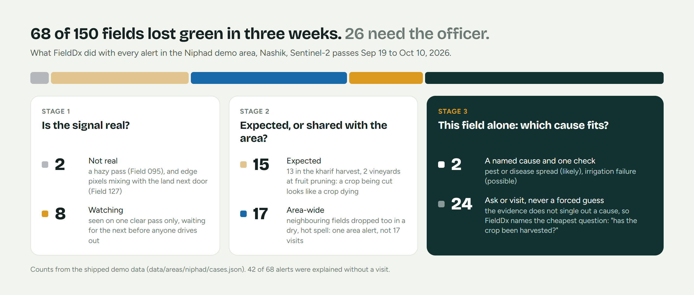
</p>

That is the real Niphad demo area, not a mock-up: **42 of 68 alerts explained without anyone getting on a motorcycle**, and the 26 that remain arrive with a reason, a ranking and a question to ask.

### Three promises

- **It throws out its own false alarms, and says why.** Most tools only show hits. Showing the cloud and the harvest it dismissed is what makes the hits believable.
- **The language model never invents a cause.** Deterministic code turns pixels into evidence and ranks the causes. Gemini only writes the plain-language case file, must cite evidence IDs that exist, and is replaced by a template if it does not.
- **When it does not know, it asks.** If nothing clears the bar, the answer is "ask or visit" with the cheapest question, never a forced guess.

## A walk through the app

Every screen below is a screenshot of the running app on real Sentinel-2 data for Niphad, Nashik.

<p align="center">
  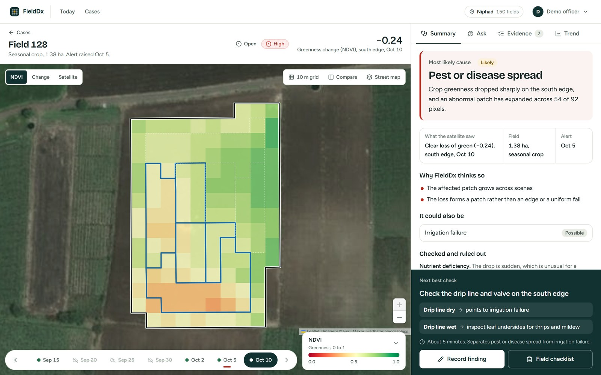
  <br><sub><b>A case.</b> Field 128, painted as its real 10 m pixels. The likely cause in plain words, what else it could be, what was ruled out, and the next best check pinned at the bottom.</sub>
</p>

<table>
<tr>
<td width="50%">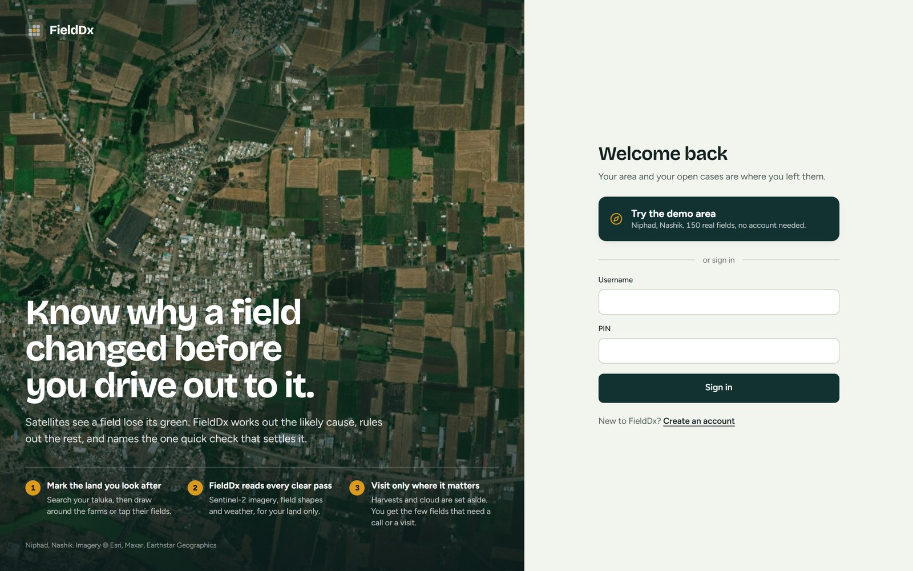<br><b>Sign in.</b> The demo area is one tap, no account needed. An officer account is a username and a PIN.</td>
<td width="50%">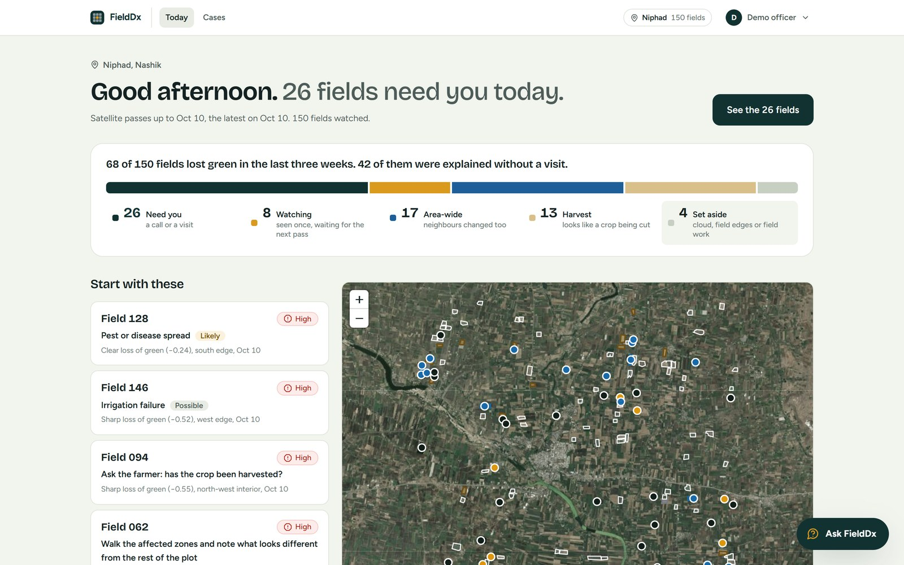<br><b>Today.</b> One sentence says how many fields need the officer. One bar shows where every other alert went. The fields to start with sit beside the map.</td>
</tr>
<tr>
<td>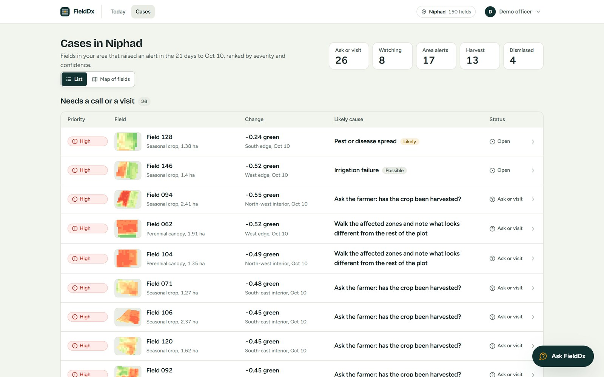<br><b>Cases.</b> Every alert, ranked by severity and confidence, each with its likely cause or the question to ask.</td>
<td>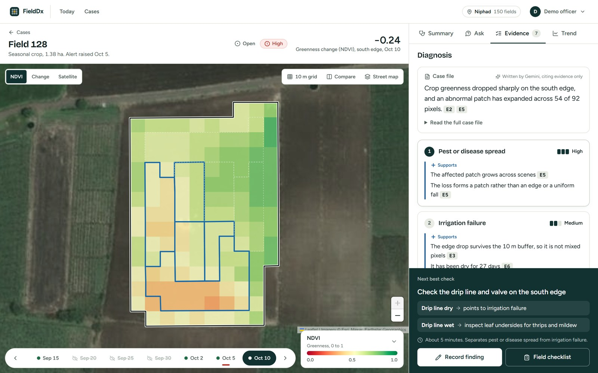<br><b>Evidence.</b> Each cause lists what supports it and what argues against it, every line tied to an evidence ID. The case file is written by Gemini and cites evidence only.</td>
</tr>
<tr>
<td>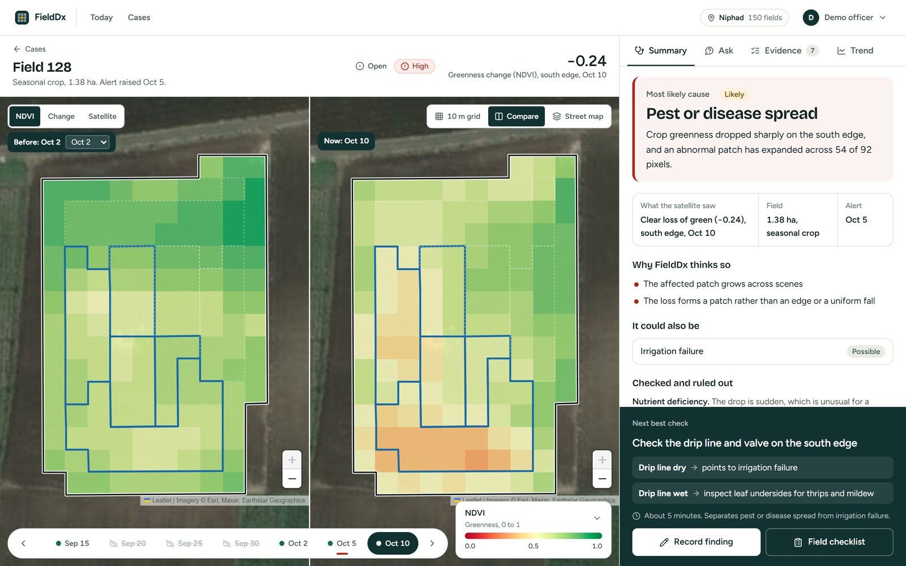<br><b>Compare.</b> Any two passes side by side. Here the south edge of Field 128 between Oct 2 and Oct 10.</td>
<td>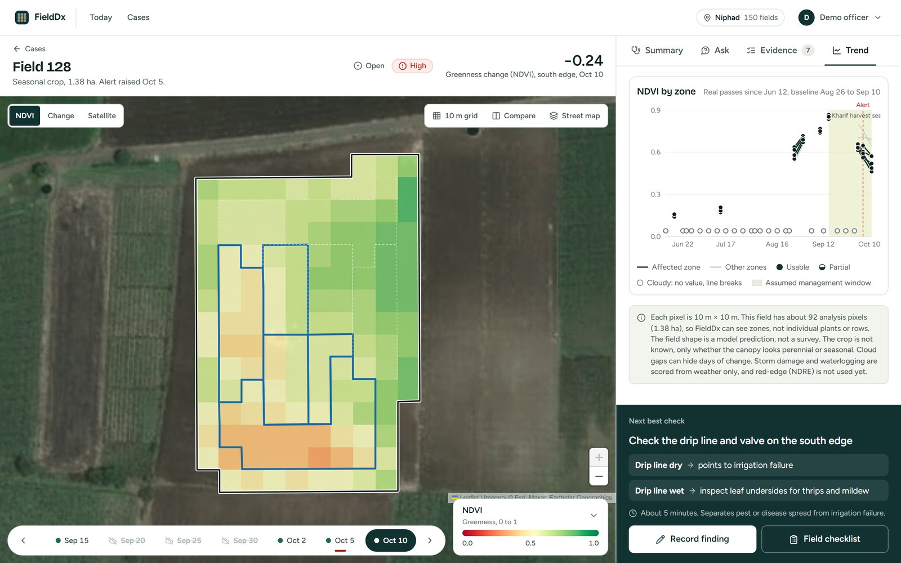<br><b>Trend.</b> NDVI by zone since June. Cloudy monsoon passes are hollow circles and never a number. The note under it says what 10 m pixels can and cannot see.</td>
</tr>
<tr>
<td>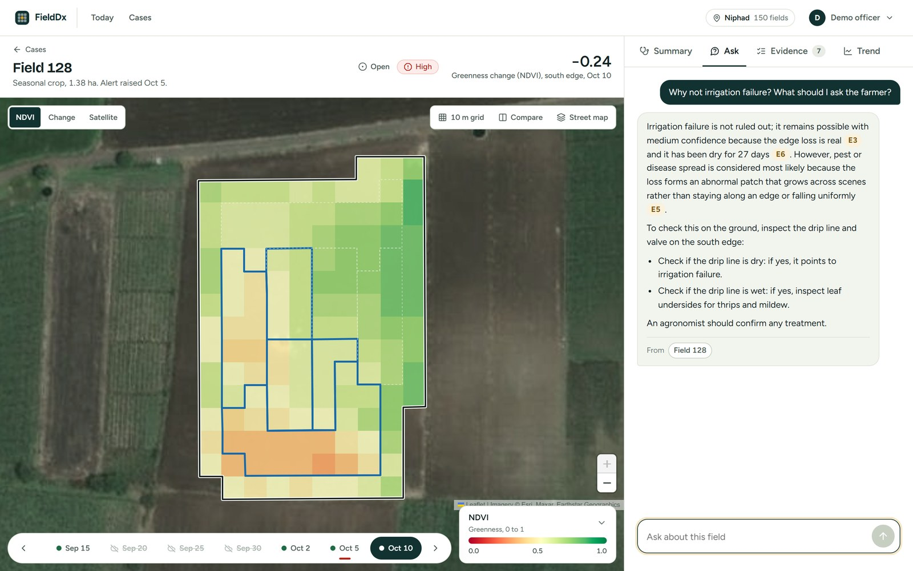<br><b>Ask FieldDx.</b> "Why not irrigation failure?" Answered from this area's own records, with the evidence it used. In English, Hindi or Marathi.</td>
<td>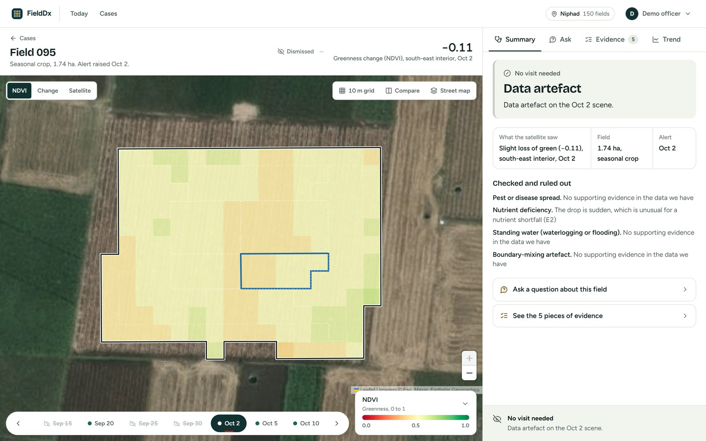<br><b>A false alarm, dismissed.</b> Field 095 dropped on a hazy Oct 2 pass and recovered. No visit needed, and the reason is on screen.</td>
</tr>
<tr>
<td>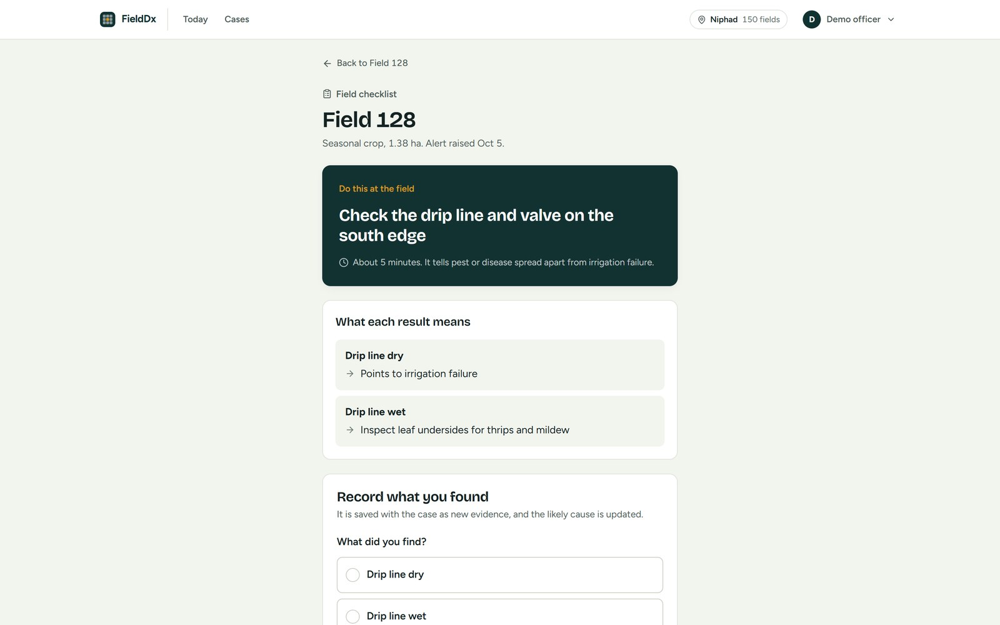<br><b>At the field.</b> One check, what each result means, and a form to record the finding, which becomes new evidence.</td>
<td>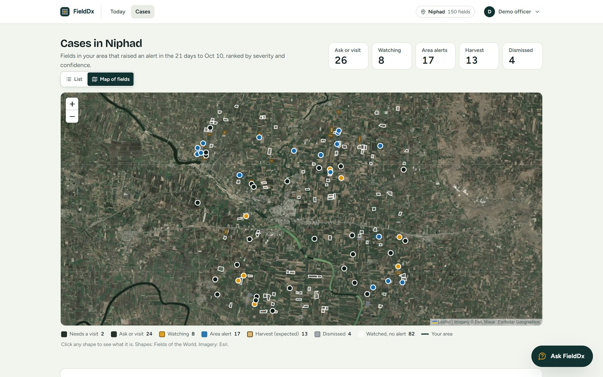<br><b>Every field.</b> All watched fields, coloured by what happened to them.</td>
</tr>
<tr>
<td>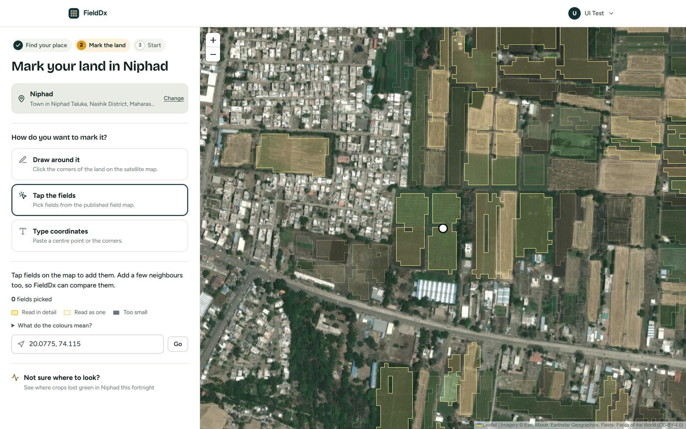<br><b>Mark your own land.</b> Search a taluka, confirm its outline, then draw around the farms, tap published Fields of the World shapes, or type coordinates.</td>
<td>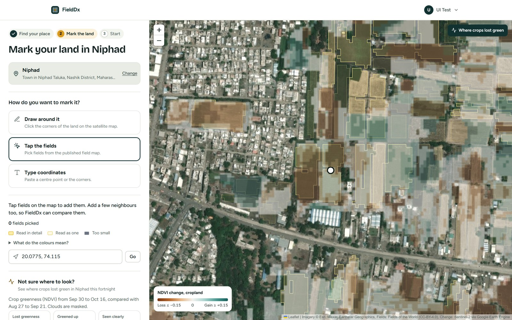<br><b>Not sure where to look?</b> This fortnight's change in cropland NDVI, computed live in Google Earth Engine. A screen, not a diagnosis.</td>
</tr>
</table>

<p align="center">
  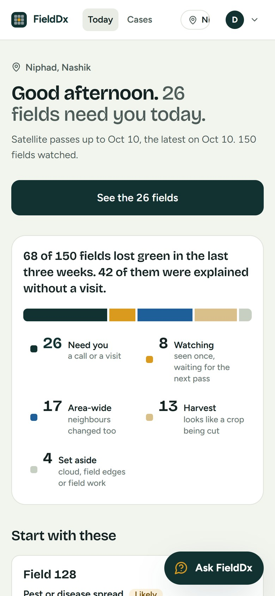
  &nbsp;&nbsp;
  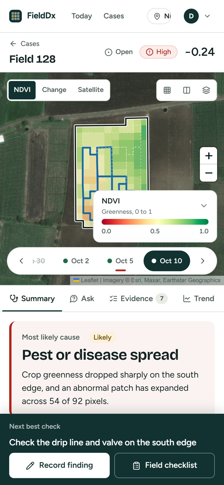
  <br><sub>Built for a phone in a field as much as a desk in an office.</sub>
</p>

## How FieldDx thinks

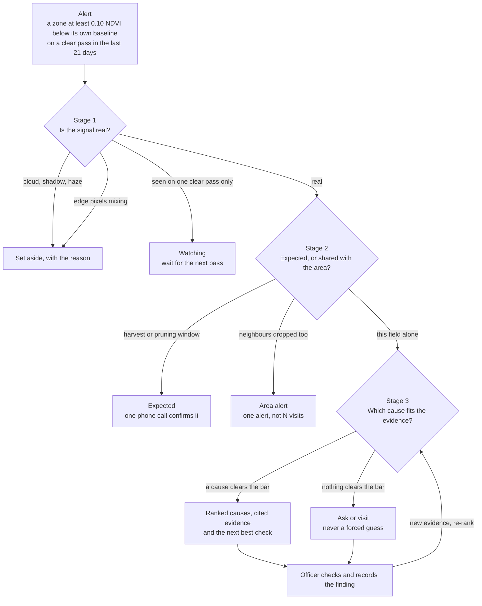

### Evidence first

Seven deterministic tools (`backend/app/tools`) turn real pixels into numbered evidence. For Field 128 they produced seven pieces, `E1` to `E7`:

| Tool | What it asks | Why it matters |
|---|---|---|
| `scene_quality` | Was the pass clear? How many clear passes since the alert? | Cloud Score+ and the scene classification layer, per pixel |
| `ndvi_series` | How big, how fast, confirmed by how many passes? | Each zone against its own baseline |
| `boundary_check` | Does an edge drop survive a 10 m inner buffer? | Rules out pixels mixing with the land next door |
| `neighbour_compare` | Did nearby fields of the same kind drop too? | Separates a field problem from an area problem |
| `spatial_pattern` | Edge, patch, spreading, or the whole field? | Patches that grow point one way, uniform falls another |
| `weather` | Dry spell, heat, heavy rain, soil moisture? | Open-Meteo, ERA5 and ERA5-Land |
| `crop_calendar` | Is this harvest or pruning season? | Inferred from the area's own NDVI |

### Eleven hypotheses, scored in three stages

A rule table (`backend/app/engine/rules.py`) holds each hypothesis as weighted conditions over those facts. A missing fact counts neither way and is shown as unknown.

| Stage | Hypotheses |
|---|---|
| 1. Is it real? | Data artefact (cloud, shadow or haze) · Boundary-mixing artefact |
| 2. Expected or shared? | Management event or harvest · Normal crop cycle · Regional dry or hot spell · Storm, hail or unseasonal rain damage · Harvest or field work across the area |
| 3. This field alone | Irrigation failure · Pest or disease spread · Nutrient deficiency · Standing water |

### The next best check is computed, not written

A doctor orders the one test that separates the top two diagnoses, not ten tests. FieldDx scores every on-site check in `data/checks.json` by how cleanly its result splits the top two causes, divided by the minutes it takes (`backend/app/next_check.py`). For Field 128, pest or disease spread against irrigation failure:

| Check | Minutes | Splits the two? | Score | |
|---|---:|---|---:|---|
| Photograph leaf undersides in the affected patch | 4 | one way only | 0.125 | **chosen** |
| Check the drip line and valve on the south edge | 5 | one way only | 0.1 |  |
| Dig 10 cm in the affected zone and feel the soil | 10 | one way only | 0.05 |  |
| Note which leaves are yellowing, old or new | 2 | no | 0 |  |
| Look for standing water and check how wet the soil is | 2 | no | 0 |  |

The officer sees the same table under *Why this check?*. A result only separates two causes if it supports one and counts against the other: a working drip line counts against irrigation failure but is not evidence for pests, so the leaf check is as informative and a minute cheaper.

### A finding updates the investigation, it does not close it

The officer records what they found at the recommended check. The finding becomes evidence, moves only the causes `data/checks.json` says it supports or contradicts, and the next check is chosen again from what is still live (`backend/app/resolve.py`). For Field 128, *Leaves clean* makes pest or disease spread less likely (0.7 to 0.2). Irrigation failure is unchanged at 0.4 and now ranks first because pests weakened, and the next check becomes the drip line on the south edge. The case shows *Investigation updated · still open*, with a word label and a reason for every cause. No cause is ever marked confirmed by ruling another out. If a finding leaves no cause standing, the case says none of the current explanations fits well and asks for a call or visit.

### Where the language model sits, and where it does not

- **It never ranks, scores or names a cause.** The engine does.
- **It writes the case file from the evidence list.** Every line must cite known evidence IDs and follow the engine's order. One retry, then a template narrative. Without a key, the app works the same.
- **Ask FieldDx is retrieval first** (`backend/app/assistant.py`). Every case and watched field becomes a short record. A question is matched by field number, then by word overlap (BM25). Gemini answers only from those records, links what it used, and is told never to invent numbers, pests or doses. An officer only ever sees their own area.

## Architecture

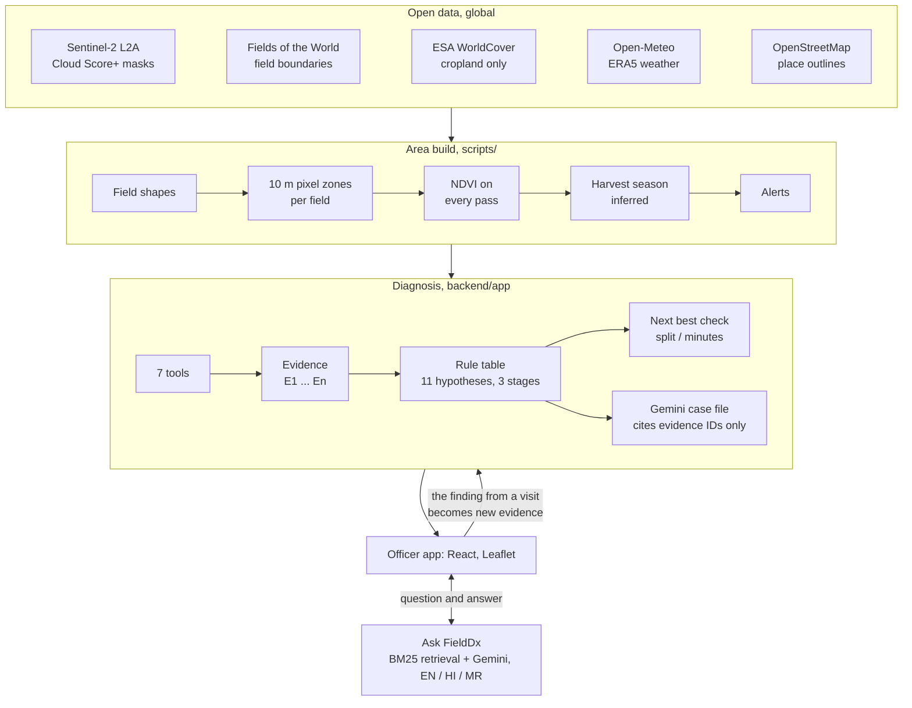

| Layer | Built with |
|---|---|
| Imagery and region change | Google Earth Engine, Sentinel-2 L2A, Cloud Score+, ESA WorldCover |
| Field boundaries | Fields of the World: the published FTW Global map, or the FTW model run on fresh scenes |
| Weather | Open-Meteo archive (ERA5, ERA5-Land) |
| API | Python, FastAPI, SQLite, a build subprocess per area |
| Diagnosis | Plain Python tools and a rule table, unit tested on known answers |
| Language | Gemini, validated against the evidence list, with a template fallback |
| App | React, Vite, TypeScript, Leaflet, PMTiles |

## Built on real data

Nothing in the app is simulated. Every number traces back to a real source.

| What | Source |
|---|---|
| Field shapes | **Fields of the World** (FTW). Either the published FTW Global map (PRUE model, 2024 and 2025, about 3.2 billion fields,<sup>[9]</sup> read per state from Source Cooperative), or the FTW model (PRUE EfficientNet-B5, CC-BY weights) run on fresh Sentinel-2 scenes of the area, as for the Niphad demo. From the published map, the latest year is the base and an earlier year's field is added where it fills a gap (at most a quarter of it under a latest-year field). A shape is a remote-sensing field unit, not a legal parcel. |
| Corrections | The **field officer**: fields drawn, split, merged or removed on the map. They are kept in the area's `edits.json`, applied again on every rebuild, and named in the provenance. |
| Places | **OpenStreetMap** through Nominatim: the region's name and real boundary. |
| Imagery | Copernicus **Sentinel-2 L2A** at 10 m through Google Earth Engine. Cloud, shadow and cirrus are masked per pixel with **Cloud Score+** (0.60) and the scene classification layer. |
| Cropland | **ESA WorldCover 2021** keeps only cropland: no river, town or trees. |
| Weather | **Open-Meteo** archive (ERA5 and ERA5-Land reanalysis): rain, heat, humidity and soil moisture. |
| Alerts | Detected from the data by `scripts/build_cases.py`: a zone at least 0.10 NDVI below the field's own baseline on a clear pass in the last 21 days. No case is hand-picked. |
| Region overview | The same Sentinel-2 and Cloud Score+ masks, computed live over the whole region: median NDVI of the last 16 days against 25 to 50 days ago, cropland only. |

What is **assumed, and says so wherever it is used**:

- **The crop is not known.** Each field is called *perennial canopy* or *seasonal crop* from a year of NDVI.
- **Management windows are not known either.** In a new area the harvest season is inferred from the area's own NDVI: the months in which last year's median seasonal field fell by 0.10 or more. Niphad keeps its grape-pruning and kharif-harvest placeholders. None of these is verified with an agronomist.
- **Small fields are read as one zone.** A field of 0.8 ha or more with some width to it is split into eight zones. A smaller, thinner or irregular field down to 0.2 ha is read as one zone, its core pixels. Its drop, neighbours, weather and season still count, but where in the field the loss sits does not, so the boundary and pattern checks are skipped, and no cause is stated with high confidence. Fields under 0.2 ha (about 20 pixels) are not watched.

## India first

FieldDx starts in India because that is where the gap between imagery and action is widest, and where the smallest fields make the problem hardest.

**Built around how Indian agriculture is actually organised.**

- **The officer is the user, not the farmer.** FPO field officers, agriculture assistants and KVK staff triage hundreds of plots each. FieldDx is an inbox for that job, not another farmer app.
- **Talukas, not bounding boxes.** An officer searches *Niphad taluka* or *Vairag tehsil*, confirms the outline, and marks the land they look after. A few square kilometres build in five to ten minutes.
- **Smallholder fields, honestly.** Around Solapur most published field shapes are under 0.8 ha. FieldDx reads those as one zone and says so, rather than pretending to see inside them.
- **Monsoon cloud is normal.** Cloudy passes are kept in the timeline as gaps and never turned into numbers. A drop seen on only one clear pass is *watched*, not escalated.
- **The officer's language.** Ask FieldDx answers in English, Hindi and Marathi.
- **Areas built so far on this codebase** include Niphad and Kolhapur district in Maharashtra, Baramati in Pune, Kurhani in Bihar and Jagraon in Punjab, all from the same open sources.

**Where it plugs into India's public systems next.** These are directions, not partnerships:

| System | How FieldDx could fit |
|---|---|
| **AgriStack** Digital Crop Survey, 23.90 crore plots across 461 districts in Rabi 2024-25<sup>[4]</sup> | The crop sown registry would replace FieldDx's biggest assumption, *the crop is not known*, with the crop the surveyor recorded. |
| **PMFBY** and **YES-TECH**, with a 30 % weightage on remote-sensing yields for paddy and wheat since Kharif 2023<sup>[5]</sup> | Triage before a loss assessment: which drops are cloud, harvest or area-wide, and which fields need a person on the ground. |
| **10,000 FPOs** under the national scheme<sup>[3]</sup> | One officer, one area, one inbox per FPO, with cases and findings shared between colleagues in the same area. |
| **Krishi Vigyan Kendras** and state extension | Recorded findings become a record of what officers actually found, field by field, season by season. |

## Then the world

Nothing in FieldDx's data stack is Indian. Every source already covers the planet:

| Ingredient | Coverage |
|---|---|
| Sentinel-2 imagery and Cloud Score+ | Every land surface, about every 5 days |
| Fields of the World Global | Wall-to-wall field boundaries, about 3.2 billion fields<sup>[9]</sup> |
| ESA WorldCover | Global land cover at 10 m |
| Open-Meteo, ERA5 | Global weather reanalysis |
| OpenStreetMap | Place names and boundaries worldwide |

What changes from one country to the next is small and kept as data, not code:

- **The check catalogue** (`data/checks.json`). The drip line that settles a case in a Nashik vineyard becomes a soil probe in a rain-fed maize field or a look at the canal gate on an irrigated one.
- **The calendar.** Already inferred from each area's own NDVI; a national crop calendar would sharpen it.
- **The language** of the case file and of Ask FieldDx.

The people who would use it are the same everywhere: an extension worker with a few thousand farmers, a cooperative agronomist, a crop insurer deciding where to send an assessor, an NGO running a smallholder programme. Five of every six farms on Earth are smallholdings.<sup>[7]</sup> They all need the step after the picture.

## What it cannot do yet

- **10 m pixels.** FieldDx sees zones of a field, not rows or plants. Fields from 0.2 to 0.8 ha are read as one zone, so it cannot say where in them a loss sits, and some of their pixels mix with the land around them. Fields under 0.2 ha are not watched. An area keeps up to 400 fields.
- **Cloud gaps.** In the monsoon, days can pass without a clear view. Those passes are shown as gaps, never as numbers.
- **Not modelled yet:** red-edge (NDRE) evidence, elevation for waterlogging, and a real crop calendar. Storm damage and waterlogging are scored from weather only.
- **The region overview is a screen.** It shows where greenness dropped, not why. The diagnosis comes from marking the land and building it.
- **Field shapes are not complete.** No automatic map finds every smallholder field. Around Vairag (Solapur), Fields of the World puts a shape on under half the land; most of the rest is roads, houses and trees, but some is fields the model missed or joined together. The map shows those gaps, and the officer closes them with **Correct fields**.
- **Accounts are deliberately simple:** a username and PIN, with no password reset or roles.

### Next

- Red-edge (NDRE) and moisture (NDMI) evidence from the 20 m bands, so a leaf check is needed less often.
- The crop from AgriStack's crop sown registry instead of *perennial or seasonal*.
- Elevation for waterlogging, and rainfall from the area's own gauges where they exist.
- More Indian languages for the case file and Ask FieldDx, starting with Kannada, Telugu and Punjabi.
- Learning from past findings: what officers found, used as priors for the next case in the same area.

## Run it

Requires Python 3.11 or newer and Node 20 or newer. The Niphad demo area ships in `data/`, so the app runs offline once installed.

```bash
cd backend
pip install -e ".[dev]"
python -m uvicorn app.main:app --port 8000
```

In a second terminal:

```bash
cd frontend
npm install
npm run dev
```

Open <http://localhost:5173> and choose **Try the demo area**, or create an account and set up an area of your own. The dev server proxies `/api` to port 8000. For a single process, run `npm run build` in `frontend/` and the API serves the built app at <http://localhost:8000>.

The API does not reload itself. Restart it after pulling new code.

Setting up new areas and the region overview also need the pipeline packages and Earth Engine on the server:

```bash
pip install -r scripts/requirements.txt
earthengine authenticate
```

Run the tests with `python -m pytest` in `backend/`. `tests/test_field128_demo.py` checks the demo case on the real data: the first check, and what *Leaves clean* changes.

For a demo recording, set `FIELDDX_LLM=off` so the case file always comes from the template, and run `python scripts/reset_demo.py` before each take.

## Reference

<details>
<summary><b>The officer's flow, step by step</b></summary>

```
Sign in                        the demo area is one tap; an account is a username and a PIN
  -> Find your place           search a taluka or district; its outline shows on the map and you confirm it
  -> Mark the land             draw around it, tap published fields, or type coordinates
  -> FieldDx builds it         real field shapes, a year of Sentinel-2, weather, then the alerts
  -> Today                     how many fields need you, where every other alert went, the fields to start with
  -> A field                   the likely cause in plain words, what else it could be, and the one check
  -> Record a finding          it becomes evidence, the ranking updates, the next check is chosen again
  Ask FieldDx, anywhere        questions about any field, answered from the area's own records
```

1. **Sign in.** The sign-in page opens on real satellite imagery (Esri World Imagery) of the demo fields. *Try the demo area* opens the shipped Niphad area (Nashik) without an account; otherwise sign in or create an account with a username and a 4 to 8 digit PIN.
2. **Find your place.** Search a district, taluka or village. Picking a result only shows its outline on the map and asks *Is this the right place?*. Nothing is locked or fetched until the officer confirms. An area a colleague has already set up can be joined instead.
3. **Mark the land.** Choose how: **draw around it** (the default), **tap the fields** on the published Fields of the World map, or **type coordinates** (one point for a square of 2 to 12 km, or three or more corners). A farm's coordinates fly the map there. *Not sure where to look?* opens, on request only, this fortnight's change in cropland NDVI across the region, computed live in Google Earth Engine, with the places where most of it dropped.
4. **FieldDx builds it.** Name the area, choose the field shapes, and start. For that polygon only, from real sources, with progress shown step by step: field shapes, about 13 months of Sentinel-2 passes, weather, 10 m pixel zones per field, the harvest season, then the alerts. A few square kilometres take five to ten minutes, and the officer can leave the page while it runs.
5. **Today.** One sentence says how many fields need the officer. One bar shows every alert of the last three weeks split into *need you*, *watching*, *area-wide*, *harvest*, *set aside* and *resolved*; each part opens that group in the case list. Beside the map are the fields to start with, each with its likely cause.
6. **Check the fields map, and correct it.** The map draws every field shape inside the area, not only the watched ones: watched fields in their case colour, harvest in wheat, shapes too small or too thin to read from 10 m pixels as dashed outlines, shapes that are not cropland as dotted ones, and land where no field shape was found as a cyan hatch. **Correct fields** lets the officer draw a field the model missed, split, merge, or remove a shape. Only that field is read again from the passes already downloaded.
7. **A field.** It opens on a **Summary**: the most likely cause in plain words, tagged *Likely* or *Possible*, what the satellite saw, why FieldDx thinks so, what else it could be, and what was checked and ruled out. The next best check stays pinned under it. The **Evidence** tab holds the full diagnosis and every check with its evidence, and can replay the investigation step by step; **Trend** has the NDVI timeline; **Ask** answers questions about this field. Recording what was found closes the case and re-ranks the causes.

The map paints the field as its real 10 m pixels on satellite imagery: NDVI, change against each pixel's own baseline, or plain satellite. Any pass can be picked from the scene bar, two dates compared side by side, and a pixel inspected under the pointer. Cloudy passes stay in the scene bar, disabled, and never show a number. Zones follow the real shape: the shape shrunk 10 m for analysis, four interior quadrants, four edges, and an unshrunk 20 m ring used only by the boundary check.

The full hypothesis table and the reasoning behind it are in [docs/idea.md](docs/idea.md). The visual language is in [docs/DESIGN.md](docs/DESIGN.md).

</details>

<details>
<summary><b>Areas, accounts, builds and the API</b></summary>

**Accounts.** Officers and sessions live in SQLite (`backend/fielddx.db`). PINs are stored as PBKDF2 hashes, and the session is an HttpOnly cookie whose token is stored hashed. The demo officer can only work in the demo area. Every route reads only the signed-in officer's area; a case ID from another area answers "not found".

**Areas.** An area is a folder, `data/areas/<id>/`:

| File | Holds |
|---|---|
| `area.json` | The polygon, how it was marked, the region it sits in |
| `fields.geojson` | The monitored field shapes, their zones, whether each is read in eight zones or as one, and the inferred class |
| `shapes.geojson` | Every field shape in the area, watched or not and why, and the land where no shape was found, for the map |
| `edits.json` | The officer's corrections to the shapes, applied again on a rebuild |
| `grids/`, `scenes/` | Each field's 10 m pixel grid, and its NDVI on every pass |
| `weather.json` | Daily weather for the area centre |
| `calendar.json` | Management windows (inferred, or placeholders for Niphad) |
| `cases.json` | The alerts the detector found |
| `build.json`, `build.log` | Build progress and output, while and after it builds |
| `raw/` | Downloaded imagery and field shapes, reused on a rebuild |

Only `data/areas/niphad` is in git. Areas built at runtime stay on the machine that built them. Findings and stored narratives are keyed by area, so areas never share or overwrite each other's cases.

**Builds.** The API runs `scripts/build_area.py` in a subprocess, one area at a time. Progress is written to `build.json` and shown on the officer's home screen. If the server stops mid-build, the build resumes when it starts again, and imagery already downloaded is kept. A build that cannot help on a retry, such as an area with no fields big enough to monitor, says so and asks for the area to be marked again.

**Map data through the API.** The state's FTW field tiles (`/api/ftw/<state>.pmtiles`) and the region overview tiles (`/api/overview/tiles/...`) are served through the API with a small cache, because many networks drop the HTTP/3 connections the upstream hosts offer.

**API.** All routes except sign-in and health need a session.

| Route | Purpose |
|---|---|
| `POST /api/auth/register`, `/login`, `/demo`, `/logout`; `GET /api/me` | Accounts and the session |
| `GET /api/places`, `/api/places/fields-source` | Place search, and where a state's field shapes are published |
| `POST /api/overview/map`, `/api/overview/summary` | This fortnight's change across a region |
| `GET /api/areas`; `POST /api/areas`; `POST /api/me/area` | List, create and join areas |
| `GET /api/area/build`; `POST /api/area/retry` | Build progress, and retrying a stopped build |
| `GET /api/home` | Today's briefing for the officer's area |
| `GET /api/cases`, `/api/cases/{id}` and `/investigate`, `/map`, `/series`, `/raster` | Cases, the live investigation stream, map and timeline data |
| `GET /api/fields.geojson`; `POST /api/area/fields` | Every field shape on the map; correct them (add, split, merge, remove) |
| `POST /api/ask` | Ask FieldDx: `question`, an optional `case_id` and the last turns |
| `POST /api/cases/{id}/findings`; `POST /api/admin/reset` | Record a finding at the recommended check (the case stays open); clear the area's findings |

</details>

<details>
<summary><b>Building an area by hand</b></summary>

The app runs the build, but `scripts/build_area.py` also works on any folder holding an `area.json`:

```bash
python scripts/build_area.py --area data/areas/<id>
```

Each step can also be run on its own:

```bash
# field shapes: the published FTW Global map for the area's state
python scripts/ftw_global.py --area data/areas/<id>

# or the FTW model on fresh imagery (needs the ftw CLI; FIELDDX_FTW points at it)
python scripts/ftw_fields.py --bbox 74.07 20.04 74.16 20.12 --year 2025 --out data/areas/niphad/raw/ftw_b5

# Sentinel-2 pixels with Cloud Score+ and SCL, plus WorldCover, on a 10 m grid in the area's UTM zone
python scripts/export_s2.py --bbox 74.07 20.04 74.16 20.12 --start 2025-10-01 --end 2026-10-13 --out data/areas/niphad/raw/s2

# weather
python scripts/fetch_weather.py --lat 20.0775 --lon 74.115 --start 2026-06-01 --end 2026-10-12 --out data/areas/niphad/weather.json

# pick the fields, build the pixel zones, cut every field out of every pass
python scripts/build_dataset.py --area data/areas/niphad

# detect the alerts
python scripts/build_cases.py --area data/areas/niphad

# correct one field shape; only what it touches is read again, then the alerts
python scripts/edit_fields.py --area data/areas/<id> --op '{"op": "remove", "key": "ftw-4110685"}'
```

</details>

<details>
<summary><b>Configuration</b></summary>

Set these in the environment or in a `.env` file at the repository root (see `.env.example`). All are optional.

| Variable | Default | Effect |
|---|---|---|
| `GEMINI_API_KEY` | none | Lets Gemini write the case file and answer Ask FieldDx. Without it, a template narrative is used and Ask returns the matching records. |
| `GEMINI_MODEL` | `gemini-3.8-flash` | The Gemini model. |
| `FIELDDX_LLM` | `auto` | `off` always uses the template narrative. |
| `FIELDDX_LLM_TIMEOUT` | `25` | Seconds to wait for the model. |
| `DEMO_PACING` | `550` | Milliseconds between investigation steps, so a viewer can follow. |
| `FIELDDX_DATA` | `data/` | Where the areas live. |
| `FIELDDX_DB` | `backend/fielddx.db` | The SQLite database. |
| `FIELDDX_EE_PROJECT` | none | Earth Engine cloud project, if your account needs one. |
| `FIELDDX_FTW` | found on `PATH` | Path to the `ftw` CLI, for running the model on fresh imagery. |
| `FIELDDX_PYTHON` | the API's Python | The interpreter that runs the build scripts. |
| `FIELDDX_NOMINATIM` | OpenStreetMap | A Nominatim search endpoint. |
| `FIELDDX_FTW_GLOBAL` | Source Cooperative | Base URL of the FTW Global partitions. |
| `FIELDDX_API` | `http://127.0.0.1:8000` | Frontend only: where the dev server proxies `/api`. |

The reset in the officer menu clears recorded findings and stored narratives in the signed-in officer's area, so a demo can start clean. From a terminal, `python scripts/reset_demo.py` does the same for the Niphad demo area.

</details>

<details>
<summary><b>Tests</b></summary>

```bash
cd backend
python -m pytest
```

- **Engine logic** is tested on a small hand-built fixture with known answers: an edge drop, a hazy pass, a boundary artefact, a pruning wave, a spreading patch, standing water.
- **The real Niphad data** is tested for invariants: polygons, grids and scenes line up, cloudy passes carry no values, every case cites only evidence it has, and the API serves a whole case.
- **Accounts and areas** are tested for sign-in, area scoping (one officer never sees another area's cases or findings), area validation, the inferred harvest season, and input checks on the tile and overview routes.
- **Field shapes** are tested for the gap fill between Fields of the World years, the land with no shape (without the slivers between shapes), each correction (draw, split, merge, remove, and the ones that must be refused), and that the demo area cannot be corrected.

The fixture exists only for tests. The product never reads it.

</details>

<details>
<summary><b>Project layout</b></summary>

```
backend/app      main.py (API), areas.py (areas and builds), places.py (place search, FTW partitions),
                 overview.py (region change), pipeline.py, engine/, tools/, next_check.py, resolve.py,
                 narrative.py, llm.py, assistant.py (Ask FieldDx), raster.py, data.py, db.py, config.py
backend/tests    engine logic on a fixture, invariants on the real data, accounts and areas
frontend/src     pages/ (SignIn, Setup, Home, Inbox, Case, Checklist), components/, styles/, session.tsx, api.ts
data/            checks.json, areas/niphad/ (the shipped demo area), areas/<id>/ built at runtime
scripts/         build_area.py, ftw_global.py, ftw_fields.py, export_s2.py, fetch_weather.py,
                 build_dataset.py, build_cases.py, edit_fields.py
docs/            brand/ (logo, banner, triage graphic), screenshots/,
                 DESIGN.md (the visual language), idea.md (the concept, the hypothesis table and the reasoning behind it)
devpost/         scope.md, prd.md, spec.md: the hackathon planning docs from the Devpost Learn skills
.agents/skills/  the Devpost Learn skill pack (1-start to 6-ship)
```

</details>

## Sources

**The problem**

1. Agriculture extension in India: one extension worker per 1,162 operational holdings against a recommended 1 : 750. *Agriculture Extension System in India: A Meta-analysis*, ICRISAT. <https://oar.icrisat.org/11401/1/Agriculture-Extension-System-in-India-A-Meta-analysis.pdf>
2. Agriculture Census 2015-16, Government of India: 86.1 % of holdings small and marginal (under 2 ha), average operational holding 1.08 ha. Press Information Bureau, *Categorisation of Farmers*. <https://pib.gov.in/newsite/PrintRelease.aspx?relid=188051>
3. 10,000 FPOs registered under the Central Sector Scheme for Formation and Promotion of 10,000 FPOs. Press Information Bureau, 8 August 2025. <https://pib.gov.in/PressReleasePage.aspx?PRID=2154174>
4. AgriStack: Digital Crop Survey in 461 districts covering more than 23.90 crore plots. Press Information Bureau, *Digital Identities to Farmers*, March 2025. <https://pib.gov.in/PressReleasePage.aspx?PRID=2117390>
5. YES-TECH under PMFBY: 30 % weightage to remote-sensing yield estimates for paddy and wheat from Kharif 2023. Press Information Bureau. <https://pib.gov.in/PressReleasePage.aspx?PRID=2085179>
6. Unseasonal rain in Nashik: about 45,000 ha of vineyards severely damaged by preliminary estimates. *Free Press Journal*. <https://www.freepressjournal.in/pune/nashik-grapes-hit-hard-by-rains-45000-hectares-of-vineyards-damaged-3500-crore-loss-feared>
7. Lowder, Sánchez and Bertini (2021), *Which farms feed the world and has farmland become more concentrated?*, World Development 142: more than 608 million farms; farms under 2 ha are 84 % of all farms and produce about 35 % of the world's food. <https://www.sciencedirect.com/science/article/pii/S0305750X2100067X> and FAO, <https://www.fao.org/newsroom/detail/Small-family-farmers-produce-a-third-of-the-world-s-food/en>
8. Extension worker to farmer ratios in Africa: about 1 : 3,000 on average, 1 : 5,000 to 1 : 10,000 in Nigeria, 1 : 1,800 in Uganda. *African Journal of Food, Agriculture, Nutrition and Development* 24(3), special issue on agricultural extension, Sasakawa Africa Association. <https://www.saa-safe.org/elfiles/l4KESreQ/AJFAND%20Volume24.No3_Special%20Issue%20on%20Agricultural%20Extension.pdf>
9. Robinson et al. (2026), *The first global agricultural field boundary map at 10 m resolution*, arXiv:2605.11055.

**Data and licences**

- **Field boundaries:** Fields of the World, Kerner et al. and Robinson et al., <https://fieldsofthe.world>. Model weights CC-BY-4.0, code MIT. FTW Global map CC-BY-4.0, on Source Cooperative.
- **Places and boundaries:** OpenStreetMap contributors (ODbL), through Nominatim.
- **Imagery:** contains modified Copernicus Sentinel data, through Google Earth Engine, with Cloud Score+ (Google).
- **Land cover:** ESA WorldCover 2021 (CC-BY-4.0).
- **Weather:** Open-Meteo, ERA5 and ERA5-Land reanalysis (CC-BY-4.0).
- **Basemaps:** Esri World Imagery, and OpenStreetMap contributors, through Leaflet.
- The NDVI colour scale, its interpretation bins and the map interaction pattern come from the author's earlier project, Pragya.

<p align="center"><br><sub><b>FieldDx</b> · Know why a field changed before you drive out to it.</sub></p>
